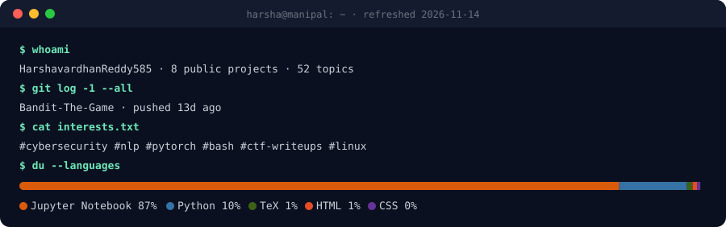

<!-- GENERATED by scripts/build.py from README.tpl.md. Edit the template; this file is rebuilt daily. -->

I'm a final-year Computer Science student at **Manipal Institute of Technology**, working on **machine learning / generative AI** and **applied security**.

I like projects that end in a measured answer: same test set, same budget, numbers in a table, and an honest write-up of the trade-offs.

### ⭐ Featured projects

| Project | What it is | Tags |
|---|---|---|
| [**uebersetzer-arena**](https://github.com/HarshavardhanReddy585/uebersetzer-arena) | English→German machine translation compared across encoder–decoder and decoder-only models: a Transformer trained from scratch, mT5-small, and Llama-3.2-1B and Gemma-3-1B (5-shot prompting and LoRA). Evaluated with BLEU, chrF, speed, a temperature analysis and a responsible-AI review on FLORES+. | `benchmark` `gemma` `huggingface` `llama` |
| [**IS_LAB_PROJECT**](https://github.com/HarshavardhanReddy585/IS_LAB_PROJECT) | End-to-end encrypted multi-user chat with Perfect Forward Secrecy: X25519 key exchange, AES-256-GCM, HKDF key ratcheting, an untrusted relay server, group chat and encrypted file transfer. | `aes-gcm` `cryptography` `end-to-end-encryption` `information-security` |
| [**autoregressive-text-generation-rnn-lstm-gru**](https://github.com/HarshavardhanReddy585/autoregressive-text-generation-rnn-lstm-gru) | Word-level text generation with Simple RNN, BiRNN, LSTM and GRU in PyTorch, compared on perplexity, accuracy, training time and sample quality over 5 seeds. | `deep-learning` `gru` `lstm` `nlp` |
| [**REMS**](https://github.com/HarshavardhanReddy585/REMS) | Real Estate Management System: property search, listings, login and enquiries. FastAPI + SQLAlchemy + MySQL backend with an HTML/CSS/JS frontend. DBMS course project at MIT Manipal. | `dbms` `fastapi` `javascript` `mysql` |
| [**PicoCTF**](https://github.com/HarshavardhanReddy585/PicoCTF) | Write-ups for 17 picoCTF challenges across binary exploitation, cryptography, forensics, reverse engineering and web exploitation. | `binary-exploitation` `cryptography` `ctf` `ctf-writeups` |
| [**Bandit-The-Game**](https://github.com/HarshavardhanReddy585/Bandit-The-Game) | Step-by-step write-ups for OverTheWire Bandit levels 0 to 13: SSH, Linux file hunting, encodings and permissions. | `bandit` `bash` `ctf-writeups` `cybersecurity` |

### 🛠️ Recently shipped

- **[Bandit-The-Game](https://github.com/HarshavardhanReddy585/Bandit-The-Game)**: Add README 12d ago
- **[cryptonite_taskphase_Harshavardhan](https://github.com/HarshavardhanReddy585/cryptonite_taskphase_Harshavardhan)**: Add README with module index 12d ago
- **[PicoCTF](https://github.com/HarshavardhanReddy585/PicoCTF)**: Add challenge index to README 12d ago
- **[IS_LAB_PROJECT](https://github.com/HarshavardhanReddy585/IS_LAB_PROJECT)**: Add top-level README 12d ago
- **[REMS](https://github.com/HarshavardhanReddy585/REMS)**: Stop tracking .env and \_\_pycache\_\_; add .gitignore, .env.example and README 12d ago

### 🧰 Tools I use

**ML:** PyTorch · Hugging Face Transformers · PEFT/LoRA · Datasets · sacreBLEU · pandas · matplotlib · Jupyter 
**Security:** pyca/cryptography · Wireshark · GDB · Linux CLI 
**Software:** Python · C · Java · SQL (MySQL) · FastAPI · HTML/CSS/JavaScript · Bash · Git · LaTeX

---

🔁 This profile maintains itself. A [daily GitHub Action](.github/workflows/refresh.yml) rebuilds it from my pinned repos, recent pushes and languages, greets you in a new language each day, and files a [health check issue](https://github.com/HarshavardhanReddy585/HarshavardhanReddy585/issues?q=label%3Aprofile-health) listing what to improve next. Last refreshed 2026-11-13.
