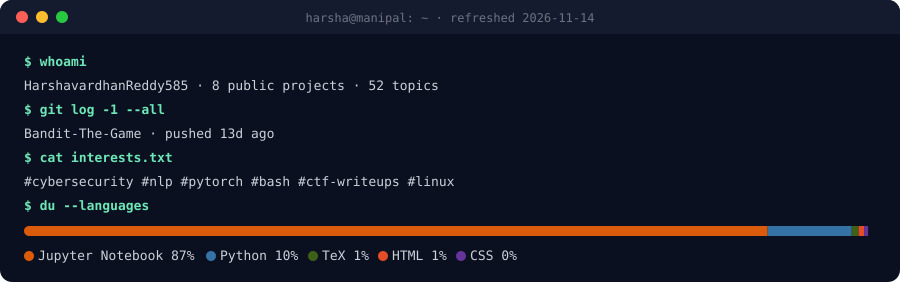

<!-- GENERATED by scripts/build.py from README.tpl.md. Edit the template; this file is rebuilt daily. -->

I'm a final-year Computer Science student at **Manipal Institute of Technology**, working on **machine learning / generative AI** and **applied security**.

I like projects that end in a measured answer: same test set, same budget, numbers in a table, and an honest write-up of the trade-offs.

### ⭐ Featured projects

{{featured}}

### 🛠️ Recently shipped

{{recent}}

### 🧰 Tools I use

**ML:** PyTorch · Hugging Face Transformers · PEFT/LoRA · Datasets · sacreBLEU · pandas · matplotlib · Jupyter 
**Security:** pyca/cryptography · Wireshark · GDB · Linux CLI 
**Software:** Python · C · Java · SQL (MySQL) · FastAPI · HTML/CSS/JavaScript · Bash · Git · LaTeX

---

🔁 This profile maintains itself. A [daily GitHub Action](.github/workflows/refresh.yml) rebuilds it from my pinned repos, recent pushes and languages, greets you in a new language each day, and files a [health check issue](https://github.com/HarshavardhanReddy585/HarshavardhanReddy585/issues?q=label%3Aprofile-health) listing what to improve next. Last refreshed {{updated}}.
